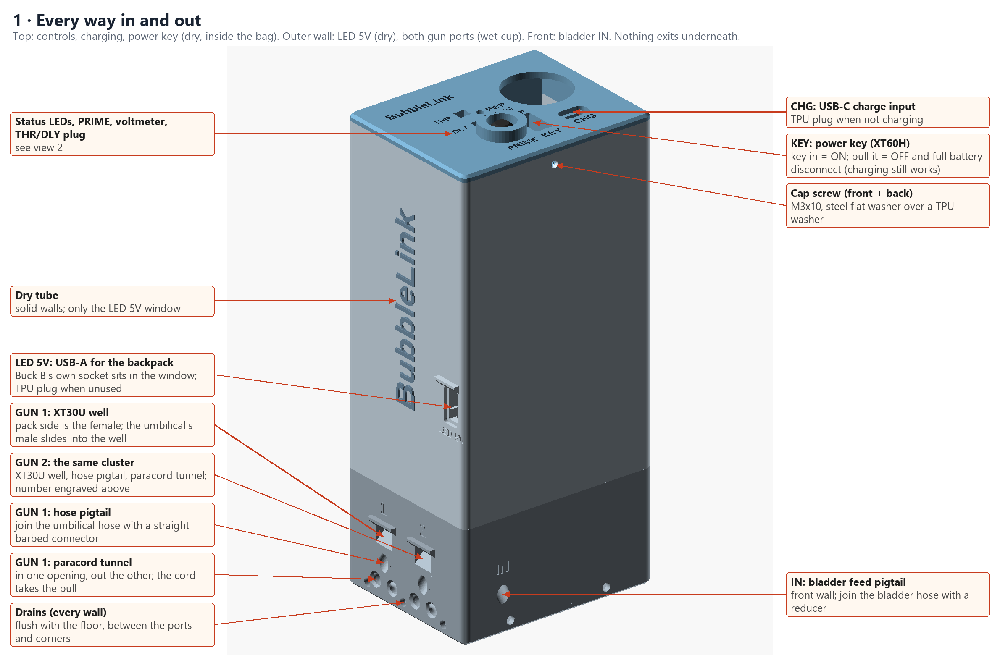
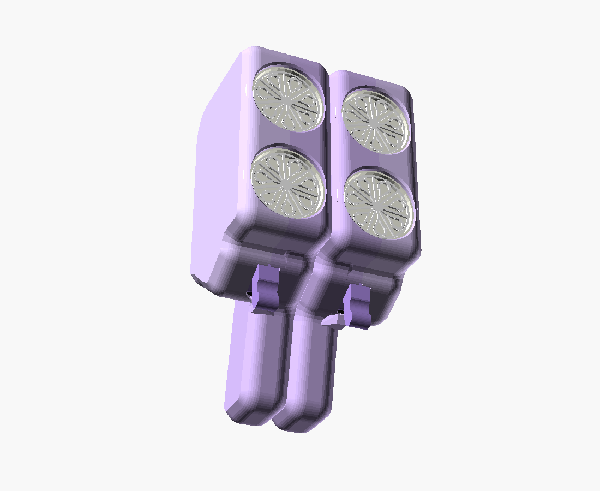
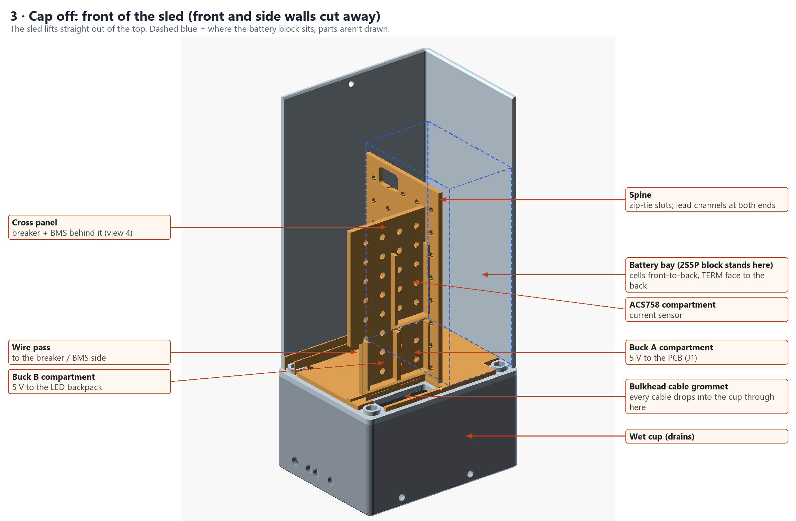
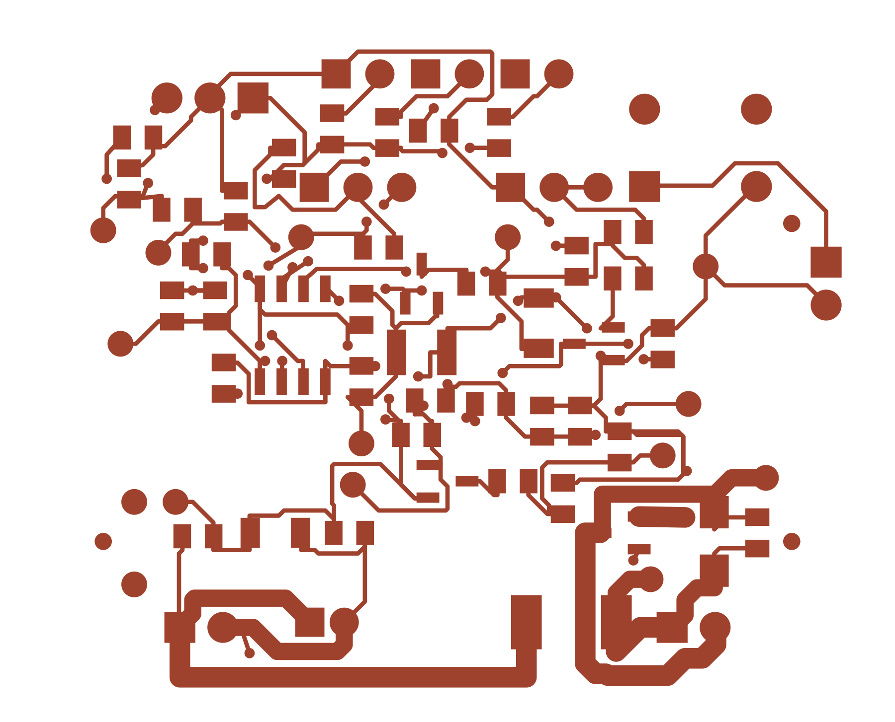
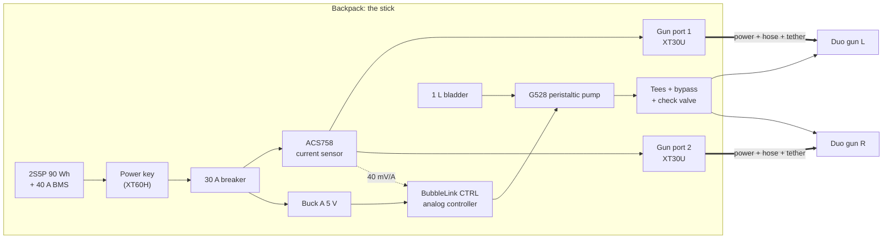

# BubbleLink

**A wearable, pack-fed bubble system: one backpack feeds two hand-held bubble guns with power and solution, and a custom analog controller runs the pump only when you pull a trigger.**

<p align="center">
  
</p>

Toy bubble guns are fun for about fifteen minutes. Then the AA cells sag, the bottle runs dry, and you are refilling a thimble of solution on a dark dance floor. BubbleLink moves the battery, the solution and the pump into a backpack and turns the guns into lightweight heads on umbilicals. Each umbilical carries power, a fluid line and a load-bearing tether. One 90 Wh pack and one litre of solution run two guns for a whole festival night.

Everything is here: the controller PCB (KiCad, Gerbers, BOM, pick-and-place, verification), every printed part (parametric OpenSCAD and ready-to-slice STLs), a full bill of materials, and build, bring-up and test guides.

| | | |
|:-:|:-:|:-:|
|  |  |  |
| **Duo guns**: a mirrored left/right pair, two blower heads each | **The stick**: battery sled, breaker, BMS and bucks over a draining wet cup | **BubbleLink CTRL v1.2**: 50 × 40 mm analog pump controller |

## Highlights

- **90 Wh 2S5P pack** (10 × Samsung 25R) with a 40 A BMS, USB-C charging, one 30 A manual-reset breaker and a pull-out power key.
- **Automatic pump control.** A Hall sensor sees gun current, a dual comparator turns the pump on, and an RC timer holds it for a tunable ~350 ms after the trigger releases. No firmware, no microcontroller, nothing to flash.
- **Two gun channels** on XT30U, each with its own fluid line and paracord tether. A dropped gun pulls on the cord, never the wires or the hose.
- **One shared peristaltic pump** with a recirculating bypass and check valve, so a stopped gun is never force-fed and the reservoir can't siphon.
- **Built for jumping.** The whole pack is one sealed upright "stick": dry tube on top, draining wet cup below, TPU seals and cushions, and nothing exits underneath.
- **Measured runtime**: about 2 hours of nonstop firing with all four heads, about 8 hours with one, and over 100 hours idle.
- **Verified before fabrication.** 50 automated release checks on the board files and a 20,000-sample Monte Carlo of the analog circuit, both re-runnable from this repo.
- **56 ready-to-slice STLs**, all watertight and designed to print without supports, generated from parametric OpenSCAD.

## How it works



1. **Pull a trigger.** The gun's motor draws current straight from the battery bus (6.0–8.4 V, unregulated). Gun current never passes through the PCB.
2. **The controller notices.** The ACS758 module reports combined gun current. One half of the TLV1822 comparator flags it against the RV1 threshold.
3. **The pump runs.** Q1 charges a hold capacitor, the second comparator half sees it high and (through Q3) turns on the AO3400A pump MOSFET, and the G528 pushes solution down both umbilicals.
4. **Release the trigger.** The hold capacitor bleeds through RV2, with Schmitt feedback for a clean edge. About 350 ms later the pump stops, so the donor pumps in the heads stay primed without flooding.
5. **Prime on demand.** The PRIME button on the cap runs the same timed path, for filling lines at the start of a night.

Every failure lands on "pump off": a supervisor clamps the timer below 4.38 V, the pump gate defaults low if the comparator is unpowered, a PTC guards the pump branch, and an unplugged sensor reads as no current. The [design description](hardware/pcb/BubbleLink_CTRL_v1_2_PCBWay/customer/DESIGN_DESCRIPTION.md) walks through every net.

## Repository layout

| Path | Contents |
|---|---|
| [`hardware/pcb/BubbleLink_CTRL_v1_2_PCBWay/`](hardware/pcb/BubbleLink_CTRL_v1_2_PCBWay/) | Controller release: KiCad source, Gerbers, SMT BOM/CPL, assembly drawing, schematic, verification |
| [`hardware/pcb/hand_solder_guide/`](hardware/pcb/hand_solder_guide/) | Illustrated guides for the through-hole parts, harness, battery and first power-up |
| [`hardware/printed/`](hardware/printed/README.md) | OpenSCAD sources (`src/`), STLs (`stl/`), renders and the full print guide |
| [`docs/`](docs/canonical-facts.md) | System design, subsystems, build guide, test plan, BOM |
| [`tests/`](tests/) | Release checks run in CI |

## Build one

1. **Get the parts.** Everything is in the [bill of materials](docs/bom.md), with part numbers and supplier search links.
2. **Order the board.** Upload [`BubbleLink_CTRL_v1_2_Gerbers.zip`](hardware/pcb/BubbleLink_CTRL_v1_2_PCBWay/fabrication/BubbleLink_CTRL_v1_2_Gerbers.zip) with the SMT [BOM](hardware/pcb/BubbleLink_CTRL_v1_2_PCBWay/assembly/PCBWAY_SMT_BOM.csv) and [CPL](hardware/pcb/BubbleLink_CTRL_v1_2_PCBWay/assembly/PCBWAY_SMT_CPL.csv) to any fab with top-side assembly. Hand-solder the ten through-hole parts using the [solder guide](hardware/pcb/hand_solder_guide/).
3. **Print the parts.** Start with the fit coupons, then follow the [print order](hardware/printed/README.md#print-order). Rigid parts are ASA, seals and cushions are TPU, and nothing needs supports.
4. **Assemble.** The [build guide](docs/10-build-guide.md) covers cell matching, the 2S5P block, the harness, sled, cup plumbing, umbilicals and the guns.
5. **Bring it up.** Follow the [bring-up and acceptance test](docs/07-pcb/bringup-and-acceptance-test.md) to set the detection threshold (RV1) and the off-delay (RV2), then run the [system test plan](docs/13-test-plan.md).

### Firmware

There isn't any. The controller is pure analog: two trimmers set its behaviour, and a multimeter and a screwdriver are the whole toolchain.

### Rebuilding the printed parts

```sh
cd hardware/printed
./build.sh /path/to/openscad      # regenerates every STL from src/ (OpenSCAD 2024+ with the manifold backend)
python check_stl.py               # watertight, one body, no overhang past 45°
```

## Verify the release

The checks that gate the PCB release and the printed parts run in CI on every push:

```sh
pip install -r requirements-dev.txt
python -m pytest -q
```

That covers the release checksums, the 50-check manufacturing validator (board outline, nets, holes, BOM, CPL, DRC, frozen hashes), the analog model with a Monte Carlo sweep, and watertightness of every STL. The full 20,000-sample run is `python3 hardware/pcb/BubbleLink_CTRL_v1_2_PCBWay/verification/analog_model/run_verification.py`.

## Documentation

**System:** [canonical facts](docs/canonical-facts.md) (the one-page source of truth) · [overview and requirements](docs/01-overview-and-requirements.md) · [architecture](docs/02-system-architecture.md) · [design decisions](docs/03-design-decisions.md) · [glossary](docs/glossary.md)

**Subsystems:** [power](docs/04-power-system.md) · [fluid](docs/05-fluid-system.md) · [guns, heads and umbilicals](docs/06-guns-heads-and-umbilicals.md) · [controller PCB](docs/07-pcb/overview.md) ([pinout](docs/07-pcb/connectors-and-pinout.md), [BOM](docs/07-pcb/bom-and-parts.md), [fabrication](docs/07-pcb/fabrication-and-assembly.md), [bring-up](docs/07-pcb/bringup-and-acceptance-test.md), [revisions](docs/07-pcb/revision-history.md)) · [printed parts](docs/09-printed-parts.md)

**Making it:** [BOM](docs/bom.md) · [build guide](docs/10-build-guide.md) · [test plan](docs/13-test-plan.md) · [roadmap](docs/16-roadmap-future-extensions.md)

## Tech

KiCad 9 · tscircuit · Gerbonara + Shapely geometry checks · Python analog model with Monte Carlo · OpenSCAD (manifold backend) · trimesh · ASA and TPU on a Creality K2 Plus and a Bambu Lab A1

## Safety

This is a 90 Wh lithium pack worn on your back. Build the battery with matched cells, keep the breaker in the + line, charge with the cap off until you have checked enclosed-charging temperature, and follow the bench gates in the test plan before wearing it.

## License

Open hardware. Hardware design files are [CERN-OHL-P-2.0](LICENSES/CERN-OHL-P-2.0.txt), software is [MIT](LICENSES/MIT.txt), and documentation and images are [CC-BY-4.0](LICENSES/CC-BY-4.0.txt). See [LICENSE](LICENSE) for which applies where.

---

Designed and built by **Joey Hersh**.
